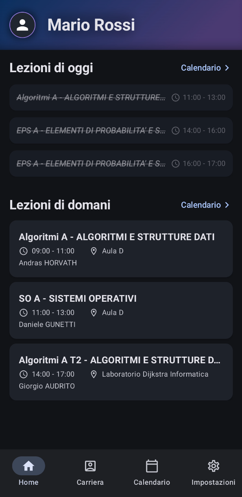
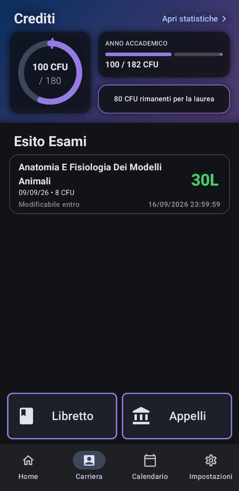
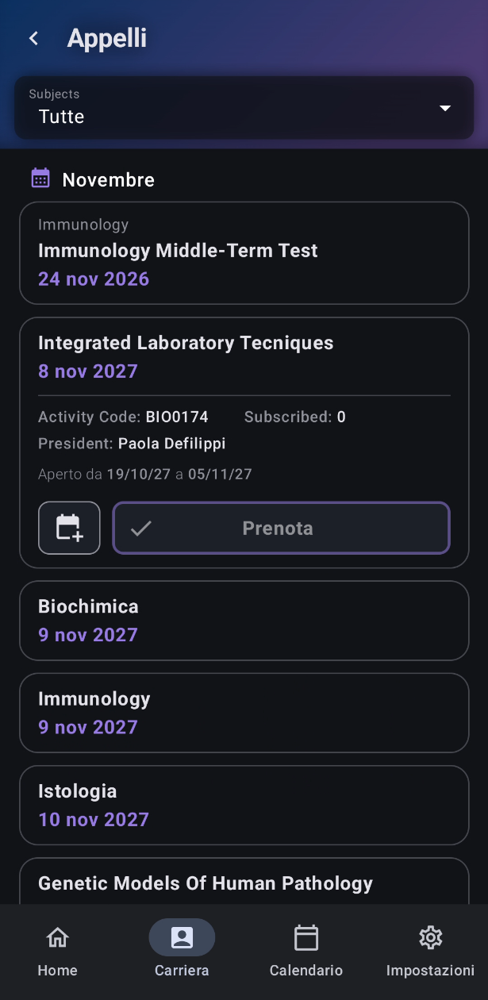
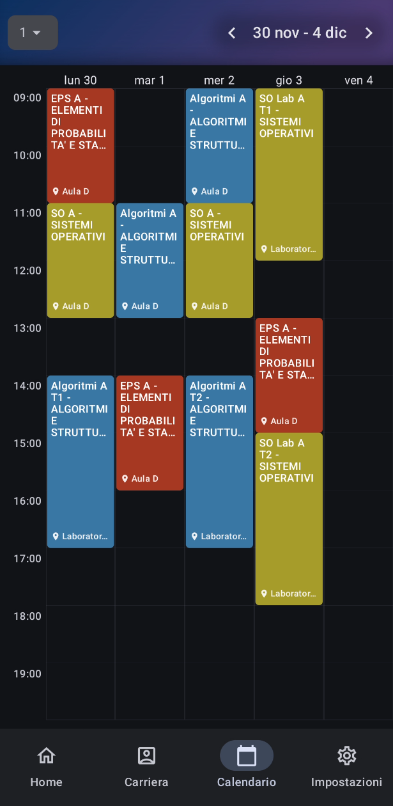

### 🇮🇹 [Vai alla versione Italiana](README.md)

# OpenUnito

**OpenUnito** is a free and Open Source university life management application,
developed as an alternative to the official app from UniTO.

 |   |  | 
:-------------------------:|:-------------------------:|:-------------------------: | :-------------------------:

> [!IMPORTANT]
> **OpenUnito is under active development.** 
> Some features still require further testing.

## Features

### Calendar
- Weekly calendar.
- Daily classes dashboard.

### Exams
- Exam booking.
- Manage exam results.
- Visualize transcript.

### Other
- Caching for offline use.
- Multiple career support.

## Privacy

We ***do not*** acquire any of your data nor send it to any third-party!

Information about you, your exams or your dog
are transferred only between the official Unito servers and your local application, 
without any intermediaries. 

**OpenUnito** ***does not*** store your credentials (name and password),
only a login token is kept.

## Installation and update

Download the latest APK release from Releases section.

Updates are managed directly inside the app in the Settings tab.

> [!NOTE] 
> Starting from 2027,
> all apps *not* published through Google Play Store, including OpenUnito, may encounter problems.
> 
> To know the reason and the updated state of this issue, 
> read more at [Keep Android Open](https://keepandroidopen.org/).

## Future features

- Attendance tracking.
- Career dashboard.
- Support for more languages.
- Theme customization setting.

## TODOs
- Implement pull to refresh (currently done only at startup).
- Improve calendar UI.
    - Overhaul ui code.
    - Handle overlapping classes.
    - Classess whitelisting.
- Make the UI more homogenous.
- Ensure accessibility features.

## Mission

We are two Computer Science students from Unito who harvested the colletive hate
for the current official application in order to 
make an alternative that is better, free
and, most importantly, maintained by the same users who utilize it.

   

 

## Contributing

This is an Open Source project, Issues and PRs are welcome.

It'd be preferable for any additions to the code to follow the already existent 
design and architectural standards.
Nevertheless, we remain open to discussing with any new ideas.

(And, please, do not completly vibecode any PR. Nobody needs it.)

## Utilization of AI

The codebase in **OpenUnito** *was not* mass generated by AI agents.

AI was utilized for the generation of small fractions of code,
which we entirely understand,
and to hasten repetitive procedures.
